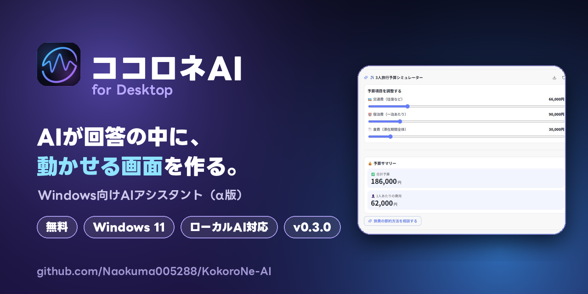
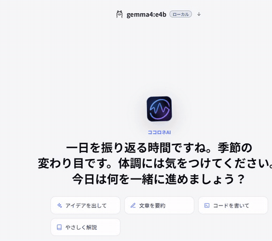
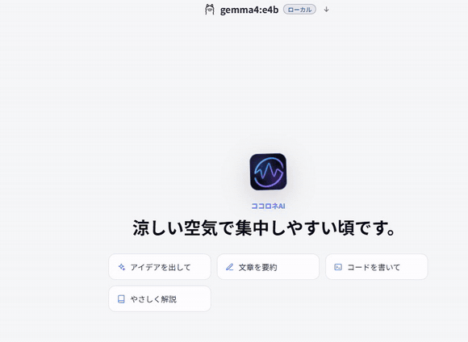
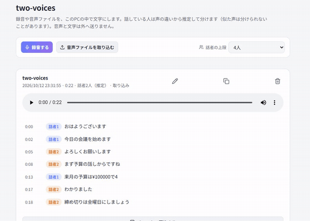
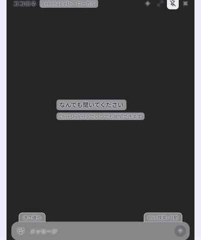
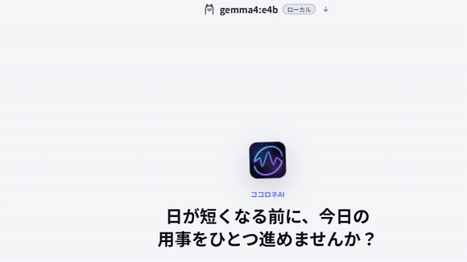

# ココロネAI for Desktop

**AIが回答の中に、動かせる画面を作る。** Windows 11向けのAIアシスタント（α版・無料）

このPCで動くローカルAI（Ollama）だけでも使えます。必要なときは外部のAI（OpenRouter・OpenAI・Anthropic・Gemini など）にも切り替えられます。

### [⬇ 最新版をダウンロード（GitHub Releases）](https://github.com/Naokuma005288/KokoroNe-AI/releases/latest)

`v0.3.0-alpha.1` ・ Windows 11 x64 ・ インストーラー（.msi）/ ZIP

> [!IMPORTANT]
> **α版です。** 不具合や開発中の機能があります。無料の自己署名のため、初回は「WindowsによってPCが保護されました」と表示されます。実行する前に、[Releases](https://github.com/Naokuma005288/KokoroNe-AI/releases/latest)に書いてあるハッシュ値と署名者を確かめてください。

## できること

### AIが、回答の中に画面を作る（Intelligent UI）

「旅行の予算を、動かして試せる画面にして」のように頼むと、スライダーや計算、グラフ・年表のある画面が回答の中に出てきます。AIが書くのは画面の設計図だけで、プログラムは実行しません。作った画面は画像（PNG・SVG）で保存できます。

### 答えを確かめやすく

Web検索の答えには、使ったサイトと記事の日付、根拠になった文章が出ます。回答はその場で編集して差分を確認でき、別のモデルでやり直して見比べることもできます。

### 話している人ごとに文字にする（音声メモ）

録音や音声ファイルを、話している人ごとに分けて文字にします。処理はすべてこのPCの中です。話者の推定が違っていたら、押して直せます。

### どこからでも呼べる（Mini Chat・Mini Dock）

`Ctrl+Shift+Space` で、どの画面の上からでも小さなチャットを呼べます。キーを押したまま話しかけることもできます。Mini Dock には音楽・タイマー・電卓・PCの状態（CPU・メモリ・GPU・電池）が入っています。

### うまくいかないときも、次の一手がわかる

失敗したときは、理由と次にやることがその場に出ます。ボタン1つでやり直せて、設定が足りなければ直すボタンも出ます。

### ほかにも

- Word・Excel・PowerPoint・PDF を、AIに送る前にプレビュー
- コマンドパレット（`Ctrl+K`）で、機能やPCのアプリを名前で呼び出し
- プロジェクトの記憶、システムプロンプト、メモリー、会話の書き出し
- コーディングモード（AIが作業し、操作はあなたが許可。元に戻すことも可能）
- 音楽の再生と歌詞、天気、URLの読み取り、通知領域への常駐、ライト / ダーク（Windowsに合わせる）

モデル・接続先・PCによって、使える機能や品質は変わります。詳しくは[機能の状態](docs/ALPHA_FEATURES.md)をご覧ください。

## 大切にしていること

1. **操作の一貫性** — 同じ見た目のものは、どこでも同じように動く
2. **状況がわかる画面** — 今なにが起きているか、待てばよいのかがわかる
3. **設定しなくても使える** — 最初から使いやすい状態で始まる
4. **自然な失敗と復旧** — うまくいかないときは、理由と次の一手を
5. **機能が増えても画面は複雑にしない**

## 対応環境

- Windows 11 x64
- Microsoft Edge WebView2 Runtime（Windows 11は標準搭載）。インストーラー版とZIPは .NET を同梱
- ローカルAIを使う場合: [Ollama](https://ollama.com/download/windows) などのローカルAIとモデル
- 外部AIを使う場合: 各サービスのAPIキー（またはChatGPTのアカウント）。**利用料金はご自身のアカウントに発生します**
- 音声メモと話しかける機能: Windowsの日本語の音声認識

AIモデルとAPIキーは同梱していません。

## はじめかた

1. [Releases](https://github.com/Naokuma005288/KokoroNe-AI/releases/latest) から `.msi`（おすすめ・管理者権限は不要）か `.zip` をダウンロードします
2. ハッシュ値と署名者を確かめてから開きます（初回のSmartScreenは「詳細情報」→「実行」）
3. 初回セットアップで、ローカルAI・外部AI・両方のどれを使うかを選びます。PCの診断で、入っているモデルやおすすめの候補がわかります
4. 前の版をお使いの方は、新しい `.msi` を開くとそのまま更新できます（会話・設定は引き継がれます）

## データとプライバシー

- 会話・設定などはこのPCの `%LOCALAPPDATA%\LumaAI-Desktop` に保存します（旧名称のフォルダー名です）。APIキーはWindowsのDPAPIで保護します
- 外部AIを使うと、回答に必要な会話や選んだ添付がそのサービスへ送られます。ローカルAIだけなら、会話はPCの外へ出ません（Web検索・天気・URLの読み取りなどを使うと、検索語やURLはその接続先へ送られます）
- 音声メモの音声と文字は、PCの外へ送りません
- 広告・アクセス解析・開発者への会話やログの自動送信はありません
- 送り先と費用は、アプリの「プライバシーと費用」の画面でまとめて確かめられます

[権限の説明](docs/PERMISSIONS.md) / [プライバシーポリシー](docs/PRIVACY_POLICY.md) / [利用条件](docs/TERMS.md) / [配布物のREADME](docs/DISTRIBUTION_README.md)

## 次のバージョン（v0.4.0 の予定）

選んだ文字のその場での翻訳・要約、他のアプリで再生中の曲の操作、省電力・オフラインの準備など、Windowsとのつながりを強くしていきます。予定は変わることがあります。

## 技術構成

C# / .NET 10、WPF、WebView2、React / TypeScript、SQLite。Electronではありません。旧名称は「ルマAI for Desktop」です（既存のブランドとの混同を避けるため改名しました）。

このリポジトリでは、紹介文・関連文書・画像と、[Releases](https://github.com/Naokuma005288/KokoroNe-AI/releases) の配布物を公開しています。アプリのソースコードはまだ公開していません。リポジトリには Apache-2.0 の LICENSE がありますが、同梱する依存物・フォント・画像の条件はそれぞれ異なります（配布物の `THIRD_PARTY_NOTICES.md` と `licenses` フォルダーをご覧ください）。

## 不具合報告・問い合わせ

アプリの「設定 › このアプリについて › 不具合の報告」で、報告用の情報（版・PC・主な設定・最近のエラー。会話やAPIキーは含まない）をまとめられます。再現手順を添えて、[Issues](https://github.com/Naokuma005288/KokoroNe-AI/issues) かメールでお知らせください。**APIキー・会話の全文・個人情報は書かないでください。**

開発者: **くなまお** ・ kunamaokunamao052867@gmail.com
